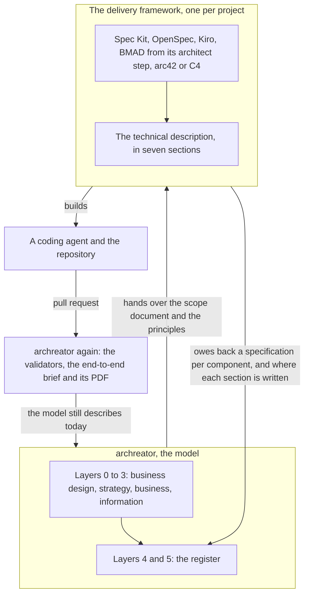

# Project Scope — The technical architecture, described end to end

_[← Scope index](./README.md) · [Model home](../README.md)_

**ArchiMate viewpoint:** Implementation & Migration.
**Delivered as:** branch `ccr-89cc65be-vffo8n` here and in
[`archreator`](https://github.com/roanboc/archreator), taking the method to
0.8.

The Requester asked to keep the method on strategy and business in enterprise
architecture terms, delegate the rest to other frameworks, and still be sure
the technical architecture can be described end to end.
[Scope 8](./8_intention-first-realization-handed-over.md) handed the design
over and left a register behind. This initiative says what the delivery
framework owes back: a technical description with a fixed set of sections,
declared once per project, reachable from every register row, and drawn on
one page from goal to platform.

## EA alignment (assessed top-down before implementing)

| Layer | Impact | Confirmed |
| ----- | ------ | --------- |
| 0_business-design | No change. The organization's `GCRE3` already says the skills turn a confirmed design into work a delivery framework builds | — |
| 1_strategy | `OUT5` added to this tree: every application component a validated model registers reaches a technical description, or says it is Pending, and the project says where each section is written. `G5` unchanged; the PDF stays, because a company on a private repository has nowhere else to publish | The shape — strategy and business stay in the model, the technical description is delegated and still reachable end to end, the PDF kept — the four work packages and the wording of `OUT5`, by the owner, in conversation, 2026-11-25 |
| 2_business | `BSVC1` names what the handover asks back: a specification per component and a declared place for each section | By the owner, in conversation, 2026-11-25 |
| 3_information | No change | — |
| 4_application | `ACMP3` gains two checks, on the register row and on the declared sections. `ACMP6` gains the end-to-end focus. `ACMP5` unchanged: its coverage report already lists what is Pending | By the owner, in conversation, 2026-11-25 |
| 5_technology | No change. A platform still earns a row only when a business fact depends on it | — |

## What the evidence said

| Source | What it said |
| ------ | ------------ |
| The method's own register | A row links to a specification and names the code. Nothing says what the specification must cover, so a component can be registered, validated and still undescribed |
| [Scope 8](./8_intention-first-realization-handed-over.md), gap notes | The standing file is written by hand, and a generator per framework was named as the next initiative |
| A survey of delivery frameworks, 2026-11-25 | Spec Kit, OpenSpec, Kiro and BMAD each write a technical design, under different file names and section names. ArcKit and BMAD also write requirements and strategy documents, which overlap layers 1 and 2 rather than continue from them. The survey was two searches and one README, not hands-on use |
| The skill corpus, by cross-reference | `document-style` is cited by nine skills and `conversation-previews` by ten; `write-pr-description` by five and `run-retrospective` by one. A lighter corpus cannot come from the rulebooks |

**The model does not need the design; it needs to know the design is
whole.** arc42 already names the sections a technical description has. The
method adopts that list as a checklist and writes none of the content.

## Where the method sits

The frameworks are alternatives. A project names one, and a framework that
also writes requirements or a strategy is started after those steps.

## Plateaus

| Plateau | State |
| ------- | ----- |
| **Baseline** (0.7) | A register row links to a specification. `AGENTS.md` § Delivery names the framework and its standing file. What the specification covers is nobody's rule |
| **Target** (0.8) | `AGENTS.md` § Delivery also declares where each section of the technical description lives. Once the register is validated, the validator holds the declaration and fails a blank register cell, and one generated page walks goal, capability, service, component, specification and platform |

## Work packages and deliverables

### WP1 — The contract

- **Deliverables:** `docs/adopting.md` § Pairing it with a delivery framework,
  with the seven sections — context, building blocks, interfaces, runtime,
  deployment, quality attributes, decisions — and where Spec Kit, OpenSpec,
  Kiro, BMAD and plain arc42 each write them; the scaffold's `AGENTS.md`
  § Delivery, with one line per section; `establish-project`;
  `docs/standards-alignment.md`, arc42 as **Adopted**.
- **Outcome:** a project says once where its technical architecture is
  written, whichever framework writes it.

### WP2 — The check

- **Deliverables:** `check_model.py` and its tests: a validated document in
  `4_application/` fails on a row with a blank cell and no Pending mark, and
  on an `AGENTS.md` whose table of seven sections is missing, short or still
  a placeholder. Both are read from the shape of the row and a marker
  comment, never from a header, so they hold in any language. A register
  still in draft owes nothing. `docs/migrating.md` has the crossing.
- **Outcome:** "described end to end" is a validator result.

### WP3 — The end-to-end view

- **Deliverables:** `build_brief.py --focus end-to-end`, one line per
  application component: the goals and capabilities above it, what it
  serves, the information it holds, the register's own cells under their own
  headers, and the platform where one is registered.
  `answer-architecture-question` offers the focus, and `docs/method.md`
  carries the diagram above. The PDF export carries the brief unchanged.
- **Outcome:** a reader follows one line from why to where it runs without
  opening the delivery framework.

### WP4 — These trees

- **Deliverables:** the elements named in the alignment table;
  `scripts/check_model.py` brought level with the method's.
- **Outcome:** both models describe the method as it ships, and pass the
  check it ships.

## In scope / out of scope

| In scope | Out of scope (gaps, candidate future work) |
| -------- | ------------------------------------------- |
| The section list, the declaration in § Delivery, the check and the view | Generating a framework's standing file from the model's principles |
| Naming BMAD beside the other frameworks, as one a project may declare | Reading a framework's documents to judge whether a section is well written |
| Bringing this repository's validator level | Collapsing this tree's layers 4 and 5 into the register, still open from scope 8 |
| | Cutting or splitting the skill corpus |
| | ArchiMate 4, still planned with the 1.0 freeze |

## Gap notes

- **A declared section can be empty.** The check proves the file exists and
  the row links to it, not that it says anything. Judging content would mean
  one parser per framework, which the portability rule refuses.
- **This tree's layers 4 and 5 are still a design.** They are draft, so the
  new check asks nothing of them. Collapsing them retires the application
  services and moves every relationship that names one, which is a
  restatement of its own.
- **The corpus is not lighter yet.** Retiring `write-pr-description` and
  `run-retrospective` would leave fifteen skills, and the second realizes
  `BPROC4.1`, so the process model moves with it. Moving the four
  organization skills to a second plugin touches `G6`. Each is the owner's
  call and gets its own initiative.
- **The standing-file generator is still open.** With the section list
  fixed, it has a target to write to, one framework at a time.
